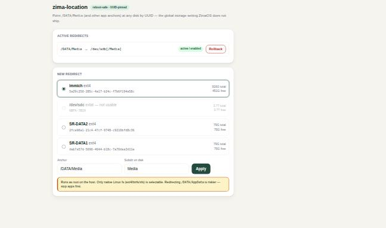

# Announcement draft (EN) — forum / Reddit r/ZimaOS, r/selfhosted

**Title:** zima-location — finally point /DATA/Media (and all your apps) at a different disk, once, reboot-safe

---

One thing that bugs a lot of ZimaOS/CasaOS users: *where* apps store their data.
Every store app hard-codes `/DATA/AppData/...` and `/DATA/Media`. ZimaOS's own
Settings → Data Migration moves whole categories, but it won't take a USB drive as
a destination for app data, and for some people the buttons simply stay greyed out.
Then you're back to editing each app's volumes by hand.

So I built a small tool: **zima-location**.

Every app points at the same anchors (`/DATA/Media`, `/DATA/AppData`), so you
redirect the anchor **once** and every present *and future* app follows. It
bind-mounts an anchor onto a subdirectory of a disk you choose.

The tricky part is doing it **safely across reboots**: ZimaOS mounts data disks
under letter paths (`/media/sdb`) that can **shift** after a reboot (plug in a USB
stick and your SATA letters move). A naive bind to `/media/sdb/...` is a time bomb.

zima-location never hardcodes a letter — a tiny `oneshot` systemd service resolves
the disk **by UUID** at every boot (`findmnt -S UUID=...`) and binds wherever it
actually is. I tested this on real hardware: after a reboot the target disk moved
from `/dev/sdd` to `/dev/sdb`, and `/DATA/Media` stayed correctly bound. 🎯

- ext4/btrfs/xfs only (exFAT/NTFS are rejected — container uid can't chown them)
- migrates existing files, keeps the original folder (renamed, not copied), one-command rollback
- `status` tells you when a target disk dropped out (USB reset) instead of leaving you with I/O errors
- auto-heal: plug the disk back in and the anchor re-binds by itself (udev rule on the disk's UUID)
- optional tiny web UI (python3)
- MIT OR Apache-2.0



**Repo:** https://github.com/chicohaager/zima-location
**Release v0.2.0:** https://github.com/chicohaager/zima-location/releases/tag/v0.2.0

```
curl -fsSL https://raw.githubusercontent.com/chicohaager/zima-location/main/install.sh | sudo bash
sudo /etc/zima-location/zima-location.sh list-disks
sudo /etc/zima-location/zima-location.sh set /DATA/Media <UUID> Media
```

There's also an optional little web UI (pick a disk → Apply). Heads-up: it runs as
root and binds localhost by default, so reach it via SSH tunnel. If you expose it,
set a token (`ZL_TOKEN`) — still at your own risk.

Not affiliated with IceWhale. Feedback / issues welcome. Test `rollback` first. 🙂
