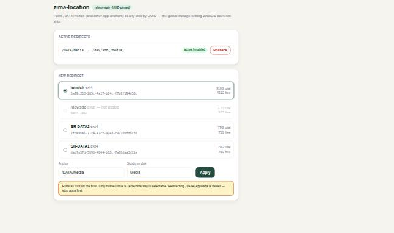

# zima-location

**Redirect where your ZimaOS / CasaOS apps store their data — once, for all apps — reboot-safe and disk-letter-proof.**



## The problem

On ZimaOS / CasaOS every app from the store hard-codes its host paths:
`/DATA/AppData/<app>` for config and `/DATA/Media` for media (the official app
packaging schema still requires `/DATA/AppData/$AppID/...`).

ZimaOS ships **Settings → Data Migration**, which moves whole categories (app data,
images, user folders) to another storage space. Its limits, per IceWhale's own docs
and staff answers in the forum:

- it works per category, not per folder you choose;
- **USB drives are not accepted as a destination** for app data (staff reply,
  ZimaOS 1.6.2, July 2026), and several users report the buttons staying greyed out;
- it does nothing about the second problem below: disks mounted under
  names that can change.

`zima-location` covers those gaps: any anchor under `/DATA`, any native-Linux-fs
disk (USB included), pinned by UUID.

## The idea

Every app points at the **same two anchors** (`/DATA/Media`, `/DATA/AppData`).
So you redirect the anchor **once** and every present *and future* app follows
automatically. `zima-location` bind-mounts an anchor onto a subdirectory of a
disk you choose — and does it **safely across reboots**.

## Why it's safe across reboots

ZimaOS mounts data disks under **letter paths** (`/media/sdb`) that can **change
after a reboot** (e.g. plugging in a USB stick shifts the SATA letters). A naive
bind to `/media/sdb/...` becomes a time bomb: after the letter shifts, the anchor
points at nothing.

USB disks still get such device-derived names in 2026 (forum reports of `/media/sda1`,
`2TB` → `2TB-2`, `/media/sdb2-ata-…` renamed by an upgrade). `zima-location` never
hardcodes a letter. It installs a small `oneshot` systemd
service that, **at every boot**, resolves the disk by its **UUID** to wherever it
is currently mounted (`findmnt -S UUID=...`) and then binds. If the letter moved,
it follows. This was verified on real hardware: after a reboot the target disk
moved from `/dev/sdd` to `/dev/sdb`, and `/DATA/Media` stayed correctly bound.

## Requirements

- ZimaOS / CasaOS (needs `/DATA`, `systemd`, `findmnt`, root)
- A target disk formatted **ext4 / btrfs / xfs**. exFAT / NTFS / FAT are
  **rejected**: a non-root container (uid 1000) cannot `chown` them, so apps
  can't use a prepared folder there.

## Install

```bash
curl -fsSL https://raw.githubusercontent.com/chicohaager/zima-location/main/install.sh | sudo bash
```

or from a checkout:

```bash
git clone https://github.com/chicohaager/zima-location
cd zima-location && sudo ./install.sh
```

Files land in `/etc/zima-location/`.

## Usage

```bash
# 1. See your ext4/btrfs/xfs data disks (incl. RAID /dev/mdX) and their UUIDs
sudo /etc/zima-location/zima-location.sh list-disks

# 2. Redirect /DATA/Media to <UUID>/Media on the chosen disk
sudo /etc/zima-location/zima-location.sh set /DATA/Media <UUID> Media

# 3. Restart any already-running app that mounts the anchor, so it picks it up
sudo docker restart <app>

# Check status / roll back anytime
sudo /etc/zima-location/zima-location.sh status
sudo /etc/zima-location/zima-location.sh rollback /DATA/Media
```

Anchors must live under `/DATA/` (e.g. `/DATA/Media`, `/DATA/Downloads`); hidden
system folders like `/DATA/.media` and the ZimaOS system disk itself are refused.

If the anchor already contained files, they are `rsync`-copied to the target and
the original folder is **renamed** to `<anchor>.pre-zl` (a timestamp is appended if
that name exists). Nothing is deleted, and the data is not duplicated on the system
disk. If `set` fails at any step after that, it rolls itself back: unit removed,
bind released, original folder renamed back.

`status` also checks each redirect's health: target disk missing (unplugged / USB
reset — the bind then answers every read with an I/O error), stale bind after the
disk was re-detected under another device, or anchor not readable.

### Auto-heal when the disk comes back

If the target disk is missing at boot, the anchor stays unbound on purpose (apps see
an empty folder instead of a wrong disk). And if a USB disk drops out at runtime and
you plug it back in, ZimaOS re-mounts it, often under a **different letter**. Without
help, nothing re-binds the anchor.

`set` therefore also installs a udev rule for the disk's UUID. When the disk appears
again, the rule starts a small heal service that re-binds the anchor **only if it is
broken** (a healthy anchor is left alone). Containers that mount the anchor keep their
old view until restarted: `sudo docker restart <app>`.

## How it works (under the hood)

- `set` writes a per-anchor unit `/etc/systemd/system/zima-location-<anchor>.service`
  (`Type=oneshot`, `RemainAfterExit=yes`, `After=local-fs.target`,
  `Before=docker.service`, `WantedBy=multi-user.target`), enables it and
  **restarts** it, so a second `set` to another disk takes effect immediately.
- `Before=docker.service`: containers start only after the anchor is bound, so no
  app writes into the empty folder on the system disk that the bind then hides.
- The unit runs `/etc/zima-location/redirect.sh <anchor> <uuid> <subdir>`, which
  resolves the UUID to its live root mountpoint (60s retry for late mounts) and
  `mount --bind`s it. Only mounts of the filesystem root count, so another anchor's
  bind on the same disk is never mistaken for the disk itself.
- Auto-heal: `/etc/udev/rules.d/99-zima-location-<anchor>.rules` matches
  `ACTION=="add|change"` on the disk's `ID_FS_UUID` (RAID member disks, which share
  the array's UUID, are excluded; md arrays announce themselves via `change`) and runs
  `systemctl --no-block start zima-location-heal-<anchor>.service`, which calls
  `zima-location.sh heal <anchor>`. The rule never mounts by itself: `systemd-udevd`
  runs with `PrivateMounts=yes`, so a mount from a udev rule would never reach the
  host. During boot `heal` stands back; the boot unit does the binding.
- `rollback` removes the udev rule first, then disables the unit, unmounts the anchor
  and removes the unit. Your data stays on the target disk.

## Optional web UI

A small browser UI (pick a disk → Apply / Rollback) is included under `ui/`.
It needs **python3** on the host (the CLI itself does not).

```bash
sudo /etc/zima-location/ui/install-ui.sh 9797   # install.sh put it there; from a checkout: sudo ui/install-ui.sh
```

> ⚠️ **Security:** the UI backend runs as **root**. It **binds `127.0.0.1` by
> default** — reach it via an SSH tunnel (`ssh -L 9797:localhost:9797 <host>`).
> Requests are guarded against DNS-rebinding / cross-site POST (Host + Origin
> checks). To expose it on the LAN set `ZL_BIND=0.0.0.0` (and ideally
> `ZL_TOKEN=<secret>`) before running `install-ui.sh` — at your own risk, behind
> the ZimaOS firewall. With a token, open the UI as `http://<host>:9797/?token=<secret>`;
> the token is stored root-only (`/etc/zima-location/ui.env`, mode 0600), not in the
> world-readable unit file. Don't expose an unauthenticated root service to an
> untrusted network.

## Notes & caveats

- **`/DATA/Media` is the safe, recommended anchor.** Redirecting `/DATA/AppData`
  is possible but riskier (live databases, permissions, ZimaOS services that
  index AppData) — do it deliberately, with apps stopped.
- The redirect is a **bind mount**, so it shares a disk. To *dedicate* a whole
  disk instead, a device mount is simpler — not this tool's job.
- Not affiliated with IceWhale. Use at your own risk; test `rollback` first.

## Tests

```bash
tests/run.sh
```

No root, no real disks, nothing written to the system. Three layers:

1. **Fakes on `PATH`** — `list-disks` / `set` against fake `blkid`/`findmnt`/`ip`:
   the `set -euo pipefail` abort class (disk without `LABEL`, unmounted UUID, host
   with no default route), system-disk and RAID filtering, `curl | bash` source
   detection, `redirect.sh` == the helper `set` actually writes.
2. **Throw-away namespace** (`tests/ns-cases.sh`, via `unshare -rm` + `chroot`) —
   real `mount --bind`, `rsync`, `mv`, `mountpoint` on tmpfs "disks": migration,
   second `set` to another disk, letter shift with two anchors on one disk, health
   check, auto-heal (rule content, no action when healthy or booting, re-bind when
   unbound), rollback, self-rollback after a failure, input guards. Needs unprivileged
   user namespaces; if they are blocked the section prints **SKIP**, it never passes
   silently.
3. **UI backend** (`tests/test_server.py`) — a real `server.py` on loopback:
   Host/Origin/token guards and body-size limits.

`shellcheck` runs as a baseline if present (skipped otherwise). Note it does **not**
catch the pipefail-abort class — verified with `-o all` against the pre-fix code,
where it reported only brace-style hints on the offending lines. The behavioural
tests are the detector for that class; keep them, don't lean on the linter.

ZimaOS has no `apt`, so grab the static binary if you want it there:

```bash
curl -fsSL https://github.com/koalaman/shellcheck/releases/download/v0.10.0/shellcheck-v0.10.0.linux.x86_64.tar.xz \
  | tar -xJ && install -m 0755 shellcheck-v0.10.0/shellcheck ~/.local/bin/shellcheck
```

## License

Licensed under either of

- Apache License, Version 2.0 ([LICENSE-APACHE](LICENSE-APACHE))
- MIT license ([LICENSE-MIT](LICENSE-MIT))

at your option. Unless you explicitly state otherwise, any contribution
intentionally submitted for inclusion in this work shall be dual licensed
as above, without any additional terms or conditions.

---

## ☕ Support

If this project saves you time, you can buy me a coffee — it keeps the side projects going.

<!-- bmc-button -->
[](https://buymeacoffee.com/holgi18114)

… or scan the code:

<a href="https://buymeacoffee.com/holgi18114"></a>
